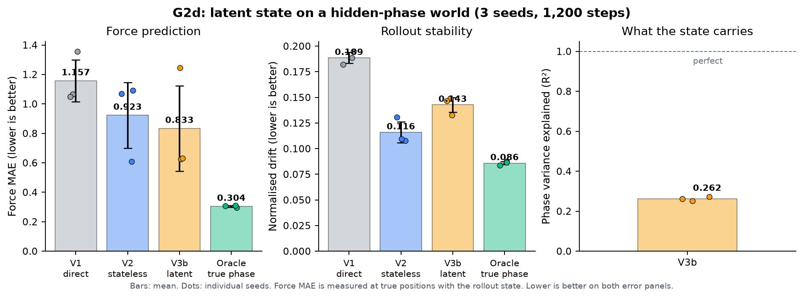

# G2d — latent state when memory is necessary: results

G2b and G2c showed that persistent latent state does not help on conservative
systems, where there is nothing to remember. G2d removes that excuse. It tests a
multi-particle world with a hidden per-particle phase: a quantity that is not a
function of the current positions, evolves in time, and contributes a force. A
stateless model cannot observe it; a model with persistent state should be able
to infer it from the first few displacements and track it. This document reports
the three-seed result. The short answer is that the state carries *some* phase
information, but not enough to beat the stateless baseline reliably, and it makes
rollout drift worse.

**Bottom line**

- On the no-spring hidden-phase world, V3b's mean force MAE is **0.833** against
  V2's **0.923**, a 10% reduction, with the oracle at **0.304**.
- The improvement is not consistent: V3b wins only one of three seeds, and the
  per-seed spread is larger than the mean gap.
- V3b's rollout drift is **0.143** against V2's **0.116**, so the state helps the
  instantaneous force but hurts trajectory stability.
- The linear state probe reaches **R² ≈ 0.26**, meaning the latent state carries
  roughly a quarter of the phase variance, not a clean estimate.
- The oracle proves the information is sufficient: with the true phase, force MAE
  drops to 0.304 and drift to 0.086. The gap is a learning problem, not a
  representation limit.
- **Verdict: G2d is an inconclusive-to-negative result for the state hypothesis.**
  It does not pass the "state is useful when memory is necessary" test.

## What we ran

The world is $N=8$ particles in a 2D harmonic well. Each particle carries a hidden
phase $q_i$ that advances with time and local density,
$\dot q_i = \omega + \kappa \rho_i$, and contributes a force
$F_i^{\text{hidden}} = A[\cos q_i, \sin q_i]$ with $A = 0.6$. At fixed $q$ this
force is the gradient of a linear potential, so an energy model can represent it
exactly; because $q$ evolves independently, the full system is non-conservative.
The first condition sets the spring stiffness to zero, so the true energy is
per-particle and a failure cannot be blamed on the neighbour perception. The
world is implemented in `npa/data/hidden_force.py`; the arms are in
`npa/models/mp_variants.py`.

| Arm | Force source | State | Role |
|---|---|---|---|
| V1 | direct MLP force | no | direct baseline |
| V2 | $-\nabla_x E(x)$ | no | strong stateless baseline |
| V3b | $-\nabla_x E(x,s)$ | per-particle, 4 dims | the state hypothesis |
| Oracle | $-\nabla_x E(x,q)$ | true phase | information ceiling, not a fair arm |

All arms share the same neighbour perception (mean relative position and a
Gaussian density) and a 64-wide tanh MLP. Training uses 1,200 Adam steps at
learning rate $10^{-3}$, a 16-step rollout position loss, and a teacher-forced
force loss with weight 1.0. Each seed sees eight training trajectories from the
same world. Evaluation uses four new worlds with the same dynamics and new
initial conditions, a 48-step horizon, and a separate parameter-shift set with
$A=0.7$, $\omega=1.1$, $\kappa=0.4$. The code is `code/g2d_train.py`; the raw
numbers are `runs/g2d_final/results.json` (three seeds, 2026-11-09).

Force MAE is measured at the *true* positions but with the state that has evolved
along the *predicted* rollout. That is the deployment metric: it couples force
quality to state quality and to trajectory drift. The training force loss is
teacher-forced, so a model can fit the force loss well and still fail this
metric. The distinction matters for reading the result.

> **In plain words.** Eight robot vacuums move in a bowl. Each has a private dial
> that pushes it in a slowly turning direction; you can see the vacuums but not
> the dials. A model without memory can learn the bowl but cannot know the push.
> A model with a scratchpad is supposed to watch the first few moves, guess each
> dial, and keep it updated. We trained both, plus a cheat that is told the dials,
> and compared how well each predicts the pushes and the paths.

## Results

| Arm | Params | Force MAE ↓ | Rollout drift ↓ | Final drift ↓ | State R² ↑ |
|---|---|---|---|---|---|
| V1 direct | 4,674 | 1.157 ± 0.173 | 0.189 ± 0.006 | 0.315 ± 0.014 | — |
| V2 stateless energy | 4,609 | 0.923 ± 0.223 | 0.116 ± 0.010 | 0.195 ± 0.023 | — |
| V3b latent energy | 5,125 | **0.833 ± 0.291** | 0.143 ± 0.007 | 0.226 ± 0.004 | **0.262** |
| Oracle (true phase) | 4,737 | **0.304 ± 0.006** | **0.086 ± 0.002** | **0.159 ± 0.004** | — |

The hidden-force amplitude is 0.6 per particle (`npa/data/hidden_force.py`), so
these absolute errors are large: V2's 0.923 is one and a half times the hidden
force itself, and even V3b's 0.833 is far from the oracle. The ranking, not the
absolute value, is the result. All four arms use the same 1,200-step protocol and
three seeds.

Per seed, the force MAE tells a less flattering story than the mean:

| Seed | V2 force | V3b force | Winner |
|---|---|---|---|
| 0 | 1.069 | 0.624 | V3b |
| 1 | 0.608 | 0.631 | V2 (near tie) |
| 2 | 1.093 | 1.245 | V2 |

The mean V3b advantage is carried by seed 0. The V3b standard deviation (0.291)
is larger than the mean gap (0.090), and with three seeds the difference is not
established. The drift result is more consistent: V3b is worse on every seed
(0.133–0.149 against V2's 0.108–0.131). That is the one signal that survives the
seed noise.

> **In plain words.** On average the scratchpad model predicts the hidden pushes
> about 10% better, which sounds like a win. But when we look at the three runs
> separately, it wins one, ties one, and loses one. Its paths are also consistently
> wobblier. A 10% average that comes from one lucky run is not a result you can
> build on.

## The state probe

A linear probe from the 4-dimensional state to $(\cos q, \sin q)$ explains 25.2%,
26.3% and 27.2% of the phase variance across the three seeds, mean 26.2%. The
probe is fitted on the states collected during the evaluation rollout, so it asks
whether the phase is *linearly decodable* from the state, not whether the state
is used well. An earlier supervised variant (`v3b_sup`) pushed the probe to about
0.38 by adding an auxiliary phase loss, but its force MAE was worse (0.991 in the
400-step smoke run), so a more decodable state was not a more useful one. That is
a useful negative: the problem is not merely that the phase is hidden; the
force objective does not reward recovering it cleanly.

> **In plain words.** We asked a simple decoder to read the hidden dial setting
> out of the scratchpad. It got about a quarter of the way there. Giving the
> model extra lessons in dial-reading made the decoder happier but did not make
> the vacuum cleaner work better, which suggests the model is optimising the
> wrong thing.

## Parameter-shift stress test

The same arms evaluated on worlds with different hidden dynamics
($A=0.7$, $\omega=1.1$, $\kappa=0.4$) give the same ordering: V2 force MAE
0.869, V3b 0.842, oracle 0.253; drift V2 0.099, V3b 0.125, oracle 0.080. The
parameter shift does not rescue the state or reverse the drift result. It is a
robustness check, not the gate; the gate is the same-dynamics evaluation above.

> **In plain words.** We also tested the models in a slightly different version
> of the room, with faster dials and a stronger push. The scratchpad still did not
> open a clear lead, and its paths were still wobblier. Changing the room did not
> change the story.

## What the numbers say

The mean force advantage is real but small and seed-dependent. The drift
degradation is small but consistent. Taken together, the state mechanism is
*partially informative and net-negative for trajectories*: it captures enough of
the phase to lower the average force error in one run, but not enough to improve
the path, and the extra state dynamics add noise.

*(inference)* Three causes are plausible, and they are testable:

1. **The state is not anchored.** The state update is a free learned delta; nothing
   forces it to encode the phase rather than a convenient but unstable summary.
   The low probe R² supports this.
2. **The force loss is dominated by the well.** The well force is smooth and easy
   to fit, so it can dominate the gradient; the phase-dependent hidden force is a
   smaller residual. A phase-aware auxiliary loss or a residual force
   parameterisation would change the balance.
3. **Teacher-forced training, rollout evaluation.** The force loss updates the
   state from true positions, but evaluation updates it from predictions. A state
   that is accurate under teacher forcing can drift when it is fed its own
   predictions. The drift result is exactly this failure mode.

The oracle rules out a fourth explanation: the architecture can represent the
hidden force and the energy model can use the phase. The information is there;
the learner is not extracting it. That is a more useful finding than a flat
negative, because it points at the state update and the loss, not at the energy
parameterisation.

> **In plain words.** The cheat model does well, so the job is possible. The
> scratchpad model does not, so the problem is how it learns to use the
> scratchpad, not whether the scratchpad could work. We have three suspects: the
> notes are not tied to the dial, the bowl's force drowns out the dial's force,
> and the model practices with the true positions but is graded with its own
> guesses.

## What this means for the project

G2d does not pass the state hypothesis. The honest read is that persistent latent
state is not yet useful on a world constructed to make it necessary. This is a
weak negative, not a refutation: the oracle shows the information is sufficient,
and the state probe shows the model is learning a fraction of it. The next state
experiment should be a targeted fix, not a bigger version of the same run. The
cheapest candidates are a supervised phase anchor with a small weight, a
state-update rule that integrates observations over time instead of adding a free
delta, and a force loss that is not dominated by the well. *(inference)*

G3 is independent of this question and proceeds: it tests whether the molecular
energy model can predict a real H + H₂ barrier from cheap labels. The state
question is deferred to a focused G2d-follow-up before G4, because a state that
cannot beat a stateless baseline on a toy world is not ready for reactive
molecular dynamics.

> **In plain words.** The scratchpad idea did not earn its place yet. We are not
> throwing it away, because the cheat shows the information is usable; we are
> saying it needs a better learning rule before we trust it on real chemistry.
> The real-chemistry test (G3) does not depend on the scratchpad, so it goes
> ahead in parallel.

## Figures

The left panel shows force MAE by arm with individual seed points; the middle
panel shows rollout drift; the right panel shows the state probe R² per seed.
Read the left panel for the mean gap and the seed overlap, the middle for the
consistent drift penalty, and the right for how much of the phase the state
actually carries.

> **In plain words.** The picture is the same story in three views: a small
> average force gain that overlaps across seeds, a consistent path penalty, and a
> scratchpad that holds only a quarter of the dial setting.

## Open questions

- Does a supervised phase anchor close the force gap without making drift worse?
- Is the drift penalty caused by state noise, or by the energy gradient becoming
  more sensitive when the state is in the loop?
- Does a larger state, or a GRU-style update, make the phase estimate robust
  across seeds?
- Does the result change with pairwise springs or larger $N$, where the density
  coupling makes the phase harder to infer?
- Is the force MAE metric unfair to V2, or does a teacher-forced comparison
  preserve the ordering?

> **In plain words.** The next experiments are about *why* the scratchpad fails,
> not about making the current run bigger. The most important question is whether
> a small supervised nudge fixes it, because that is cheap to test.

## What would change this document

- A 5–10 seed run in which V3b beats V2 on both force MAE and rollout drift.
- A supervised-state variant that reaches probe R² above 0.8 and improves drift.
- A teacher-forced force comparison that reverses the ordering, which would mean
  the deployment metric is hiding a real state advantage.
- Evidence that the drift penalty disappears with a longer training budget,
  which would make this a compute-limited result rather than a mechanism result.

> **In plain words.** If a fairer or longer experiment shows the scratchpad
> winning on both the pushes and the paths, this conclusion changes. Until then,
> the honest label is "not demonstrated".

## Sources

1. Project measurements: `runs/g2d_final/results.json` (V2/V3b/oracle, three
   seeds, 1,200 steps, no springs, 2026-11-09); `runs/g2d_v1_final/results.json`
   (V1 direct baseline, same protocol).
2. Code: `code/g2d_train.py`, `npa/data/hidden_force.py`,
   `npa/models/mp_variants.py`, `npa/models/mp_perception.py`.
3. Design and decision rule: `docs/07-delivery/10-g2d-g3-plan.md`.
4. Prior results: `docs/07-delivery/07-g1-g2-results.md`,
   `docs/07-delivery/08-g2b-results.md`, `docs/07-delivery/09-g2c-results.md`.
