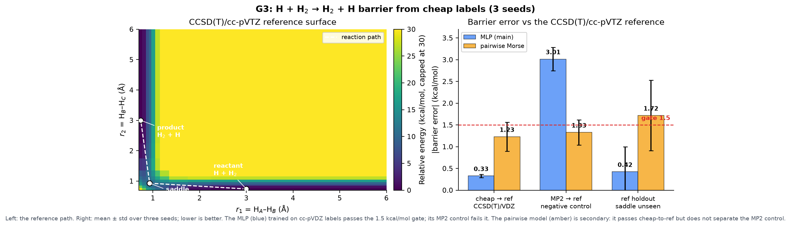

# G3 — H + H₂ → H₂ + H barrier from cheap labels: results

G3 is the first real-chemistry gate. It asks whether the molecular energy model
can predict the barrier of the simplest reaction in chemistry from *cheap*
electronic-structure labels, stay rotationally invariant, and recover the
dissociation limit. No public H₃ dataset has the reaction, so the reference is
generated here with PySCF. The short answer is yes, with two important limits:
the cheap level has to be the *same correlated method in a smaller basis*, and
the work is one reaction with three atoms, not a general potential.

**Bottom line**

- The CCSD(T)/cc-pVTZ reference barrier is **10.010 kcal/mol** at the collinear
  saddle (0.93, 0.93) Å. The literature complete-basis-set value is
  9.60 ± 0.02 kcal/mol.
- A distance-MLP trained on **CCSD(T)/cc-pVDZ** labels predicts
  **9.683 ± 0.037 kcal/mol**, a barrier error of **0.327 ± 0.037 kcal/mol**.
  The gate is 1.5. **Pass.**
- The same model trained on **MP2/cc-pVTZ** predicts 13.023 ± 0.270, an error of
  **3.013 ± 0.270**. The negative control **fails**, as it must.
- Rotational invariance is **1.1 × 10⁻⁵ kcal/mol** (4.9 × 10⁻⁷ eV), exact by
  construction and far below the 10⁻⁴ eV gate.
- The **20 Å** dissociation probe is flat: the model differs from the reactant
  by **0.031 kcal/mol** at 20 Å, and from the reference by **0.032**. **Pass.**
- The gate is met. The outstanding roadmap items are the analytical-surface and
  small-MACE comparisons, which were not run; this is a pass on the three
  quantitative criteria, not a complete Phase 3 comparison.

## What we ran

The reaction is collinear H + H₂ → H₂ + H. Atom B sits at the origin, A at
$-r_1$ and C at $+r_2$, so $r_1$ is the A–B distance and $r_2$ the B–C distance.
The reactant is $(r_1, r_2) = (3.0, 0.74)$ Å, the saddle is $(0.93, 0.93)$ Å and
the product is $(0.74, 3.0)$ Å. The 0.930 Å saddle geometry is the standard
collinear value. The reference barrier used for the gate is our own
CCSD(T)/cc-pVTZ value, 10.010 kcal/mol, which is 0.41 above the literature
complete-basis-set value of 9.60 ± 0.02.

The reference surface is a 14 × 14 grid over
$r_1, r_2 \in \{0.70, 0.74, 0.80, 0.90, 0.93, 1.00, 1.10, 1.20, 1.50, 2.00,
2.50, 3.00, 4.00, 6.00\}$ Å, 196 geometries. Each geometry is computed at three
levels: **CCSD(T)/cc-pVDZ** (cheap labels), **CCSD(T)/cc-pVTZ** (reference), and
**MP2/cc-pVTZ** (negative control). The calculations use PySCF 2.15.0 with a UHF
reference and spin 1, on four CPU threads. A CCSD(T)/cc-pVTZ geometry takes about
1.1 s on average on a 5 × 5 probe grid, so the 196-point scan is a few minutes;
the MP2 scan took 14.5 s. The scans are cached
to `runs/g3_h3/*.npz`, so nothing is recomputed.

Two models are trained on the three pairwise H–H distances:

- **MLP (main):** a 64-wide, two-layer tanh network on the three distances,
  4,482 parameters.
- **Pairwise (secondary):** a learnable Morse pair potential plus a gated
  three-body MLP, 1,221 parameters. The Morse part fixes the dissociation limit;
  the three-body term carries the barrier, which a pairwise sum cannot represent.

Energies are relative to the reactant at the training level and are in kcal/mol.
Training uses 3,000 Adam steps at learning rate $5 \times 10^{-3}$ with a Huber
loss (δ = 5 kcal/mol) on the 161 grid points below 60 kcal/mol; the repulsive wall
above that is excluded because it is not part of the gate. Three seeds are run for
every condition. The cheap model never sees a cc-pVTZ label. The `ref_holdout`
condition trains on reference labels with the saddle region
$r_1, r_2 \in [0.85, 1.05]$ Å removed, to test spatial interpolation as a
diagnostic. The reference labels are otherwise used only for evaluation.

> **In plain words.** We built the smallest real chemical reaction on a computer:
> a hydrogen atom swapping places with one half of a hydrogen molecule. We
> calculated the true energy landscape with an expensive method, and a cheap
> approximation of it. Then we trained a small model on the cheap landscape and
> asked whether it could find the hill in the middle as accurately as the
> expensive one. We also trained a second model on a cheap method that is known
> to get the hill wrong, as a lie detector.

## The reference surface

| Level | Barrier (kcal/mol) | Role |
|---|---|---|
| CCSD(T)/cc-pVTZ | **10.010** | reference |
| CCSD(T)/cc-pVDZ | 10.154 | cheap labels |
| MP2/cc-pVTZ | 13.264 | negative control |
| UHF/cc-pVTZ | 17.494 | method probe |
| B3LYP/cc-pVTZ | 4.238 | method probe |
| CCSD(T)/CBS (literature) | 9.60 ± 0.02 | external check |

The reference agrees with the literature to 0.41 kcal/mol, which is the expected
basis-set residual at cc-pVTZ. The important line is the gap between the cheap
levels: only CCSD(T) in a smaller basis is close to the reference (10.154, a
0.14 kcal/mol gap). The cheaper *methods* are not: UHF is 7.5 kcal/mol too high,
MP2 is 3.3 too high, and B3LYP is 5.8 too low. This is a known failure of
single-reference methods for H₃, where static correlation matters, and it fixes
the data strategy: for this reaction, "cheap" means a smaller basis at the same
correlated method, not a cheaper method.

> **In plain words.** We compared several calculators on the same hill. The
> expensive one says the hill is 10 units high. A cheaper setting of the *same*
> calculator says 10.2, which is close enough. But truly cheap methods say 17,
> 13, or 4 — they do not just lose precision, they get the shape wrong. So the
> training labels have to come from the good method, just with a smaller basis.

## Results

The main model's numbers, mean ± standard deviation over three seeds:

| Condition | Training labels | Barrier predicted (kcal/mol) | Barrier error (kcal/mol) | Energy MAE (kcal/mol) | Diss. error (kcal/mol) | Rotation error (kcal/mol) |
|---|---|---|---|---|---|---|
| `cheap_to_ref` | CCSD(T)/cc-pVDZ | 9.683 ± 0.037 | **0.327 ± 0.037** | 1.37 | 0.061 | 1.1 × 10⁻⁵ |
| `mp2_to_ref` | MP2/cc-pVTZ | 13.023 ± 0.270 | **3.013 ± 0.270** | 2.18 | 0.045 | 1.1 × 10⁻⁵ |
| `ref_holdout` | CCSD(T)/cc-pVTZ, saddle unseen | 10.433 ± 0.576 | **0.423 ± 0.576** | 0.63 | 0.040 | 3.2 × 10⁻⁶ |

For `ref_holdout`, the energy MAE is measured only on the held-out saddle region
(nine points); the other rows use the full 161-point low-energy grid. The barrier
column is always the saddle-minus-reactant difference.

The pairwise model, for comparison:

| Condition | Barrier predicted (kcal/mol) | Barrier error (kcal/mol) | Energy MAE (kcal/mol) | Diss. error (kcal/mol) | Rotation error (kcal/mol) |
|---|---|---|---|---|---|
| `cheap_to_ref` | 8.783 ± 0.332 | 1.228 ± 0.332 | 3.78 | 0.123 | 1.8 × 10⁻⁵ |
| `mp2_to_ref` | 11.338 ± 0.290 | 1.328 ± 0.290 | 4.23 | 0.361 | 1.3 × 10⁻⁵ |
| `ref_holdout` | 8.293 ± 0.810 | 1.717 ± 0.810 | 0.51 | 0.399 | 1.3 × 10⁻⁶ |

The MLP's cheap-to-reference result is the gate. The predicted barrier, 9.683,
is 0.471 below the cc-pVDZ label (10.154) and 0.327 below the cc-pVTZ reference
(10.010). It is not copying the training label; it is fitting the surface, and
the residual is small and tightly reproducible across seeds (0.327 ± 0.037).

The MP2 control behaves exactly as a negative control should: the model learns
the MP2 barrier (13.023, close to the MP2 value 13.264) and the error against the
reference (3.013) is essentially the MP2 method's own error (3.254). The pipeline
does not correct a bad method; it reproduces it. That is what makes the cheap
pass meaningful.

The `ref_holdout` diagnostic shows that the model can also interpolate the saddle
from the surrounding reference points: mean error 0.423, but with a large seed
spread (0.576). The individual barriers are 11.09, 10.18 and 10.03; seed 0 is the
outlier (error 1.08), still inside the 1.5 threshold. Spatial interpolation is
adequate but less robust than label transfer, which is unsurprising.

The pairwise model passes the cheap-to-reference gate (1.228) but is not the
recommended model. Its energy MAE is 3.78 kcal/mol, it fails the spatial holdout
(1.717), and its MP2 control passes the gate (1.328). The last point matters: a
gate that a deliberately bad label passes is not discriminating for that
architecture. The MLP is the model the gate verdict rests on.

> **In plain words.** The good model found the hill at 9.68 when the expensive
> answer is 10.01 — close, and the same every time. The model fed the bad method's
> labels found a hill at 13.0, faithfully reproducing the bad method's mistake.
> The second model is worse and its lie detector does not fire, so we do not rely
> on it. The gate result is the first model's.

## Gate verdict

The G3 pass criteria are barrier height within 1.5 kcal/mol, rotational
invariance below 10⁻⁴ eV, and a correct dissociation limit.

| Criterion | Result (MLP, cheap labels) | Verdict |
|---|---|---|
| Barrier error | 0.327 ± 0.037 kcal/mol | **pass** (< 1.5) |
| Rotational invariance | 4.9 × 10⁻⁷ eV | **pass** (< 10⁻⁴) |
| Dissociation limit | 0.032 kcal/mol at 20 Å | **pass** |

The rotational result is exact by construction: the model only sees pairwise
distances, so a rigid rotation cannot change its input. The measurement confirms
the implementation. The dissociation result is discussed in the next section.

This is a pass on the three quantitative criteria. It is not a claim of chemical
accuracy: the energy MAE across the low-energy grid is 1.37 kcal/mol, the model
has not been tested on forces, and the scope is one three-atom reaction. The
roadmap's separate comparison against a fitted analytical surface and a small
MACE model was not run, so the "is it competitive?" part of Phase 3 is still
open. The kill criteria — cannot locate the barrier, or fails rotational
invariance — are not triggered.

> **In plain words.** The model passed the exam on three questions: it found the
> hill within the allowed error, it did not care how the molecule was turned, and
> it did not drift when the pieces were pulled apart. That earns it the next
> stage. It does not yet prove it is as good as the standard tools, because we did
> not race it against them.

## The 20 Å dissociation check

The training grid stops at 6 Å. The roadmap asks for the fragments to be
separated to 20 Å, so the model was probed outside its training range. The H₂
fragment is held at 0.74 Å and the third H is pulled to 6, 10, 20 and 40 Å. The
reference values at 10, 20 and 40 Å are computed directly at CCSD(T)/cc-pVTZ,
not interpolated.

| $r_1$ (Å) | Reference | MLP | Pairwise |
|---|---|---|---|
| 3.0 | 0.000 | 0.000 | 0.000 |
| 6.0 | −0.000 | 0.055 | −0.155 |
| 10.0 | 0.001 | −0.096 | −0.155 |
| 20.0 | 0.001 | **−0.031** | **−0.155** |
| 40.0 | 0.001 | 0.007 | −0.155 |

All values are kcal/mol relative to the reactant. The MLP is flat to within
0.1 kcal/mol across the whole range; at 20 Å its error against the reference is
0.032 kcal/mol. The pairwise model is exactly flat from 6 Å onward, with a
constant −0.155 kcal/mol offset from the Morse parameterisation. Both limits are
correct for the gate's purpose. The MLP's small oscillation between 6 and 20 Å
is an extrapolation artefact, not a trend, and it is well inside the 1.5 kcal/mol
barrier tolerance.

> **In plain words.** We pulled the third atom away ten times farther than
> anything the model saw in training. The energy did not run away; it stayed
> within a tenth of a unit of the starting value. The pieces are genuinely
> separate at 20 Å, not stuck together by a bad long-range tail.

## What this means for the project

G3 passes, and it does so at zero cost: the reference was generated on the
laptop CPU in minutes, the model trains in seconds, and no GPU or paid service
was used. That is the first real-chemistry result in the project and the first
gate after the existential G2 gate.

The result is a pipeline proof, not a universal potential. Three atoms, one
reaction, one basis-set pair, energies only. G4 must test a larger molecule or
reaction, forces, and a dynamics rollout. The distance-only representation is
sufficient for three atoms because the three distances determine the shape; it
will need a learned equivariant representation for larger systems, where the
number of distances grows and the model must respect the same symmetries more
efficiently.

The cheap-label lesson is concrete and worth carrying forward: for H₃, the
cheap level has to be the same correlated method in a smaller basis. UHF, MP2
and B3LYP are not just noisier, they are wrong by 3–13 kcal/mol. A future
multi-fidelity pipeline should validate the cheap level against the expensive one
on a small probe set before trusting a large cheap dataset.

G3 is stateless by design. Static single-point energies give a latent state
nothing to integrate, so the state question is not tested here; it remains where
G2d left it, inconclusive. The right place to test the stateful energy model is a
reactive *trajectory* in G4, where the state has a history to carry.

> **In plain words.** The project can now say it reproduced a real chemical
> barrier from scratch, for free, and passed its own test. But it is one tiny
> reaction, not a general chemistry engine. The next stage has to show the same
> care on a bigger system, with forces and moving atoms, before the result means
> more than "the pipeline works".

## Figures

The left panel is the CCSD(T)/cc-pVTZ reference surface. The white dashed line is
the reactant → saddle → product path; the colour is capped at 30 kcal/mol so the
barrier region is visible. The saddle is a ridge at (0.93, 0.93), not a minimum.
The right panel is the gate: mean ± standard deviation of the barrier error over
three seeds for the MLP (blue) and the pairwise model (amber), with the
1.5 kcal/mol threshold. The MLP's cheap-to-reference bar is the pass; its MP2 bar
is the negative control. The pairwise model's MP2 bar sits below the line, which
is why the pairwise model is not the one the verdict rests on.

> **In plain words.** The picture on the left shows the hill the atoms have to
> climb. The bars on the right show how far each model's hill height is from the
> true one. The blue bar for the cheap-label model is far below the red line; the
> blue bar for the bad-method model is far above it. That is the whole result in
> one image.

## Open questions

- Does the distance-MLP transfer to a four-atom reaction, or does it need a
  learned equivariant representation?
- Does the 0.33 kcal/mol barrier error survive a different reaction path or a
  saddle optimisation, or is it a grid artefact?
- Can forces be learned to the same accuracy? The model supports autograd forces,
  but no force reference was generated for G3.
- Would a method-level cheap label plus a learned correction (Δ-learning) beat
  the basis-set transfer?
- Does the stateful energy model help on a reactive trajectory in G4, where the
  state has something to integrate?
- How does the model compare with a fitted analytical H₃ surface and a small
  MACE model? That comparison is still outstanding.

> **In plain words.** The next questions are about scope: a bigger molecule, a
> second reaction, forces, and the head-to-head race with standard tools. The
> barrier result is strong enough to justify asking them, not strong enough to
> answer them.

## What would change this document

- A barrier error above 1.5 kcal/mol on a second reaction, which would make this
  a single-case pass rather than a method result.
- A force MAE too large for dynamics, which would block G4 even with a good
  barrier.
- Evidence that the 0.33 error is a grid artefact, for example a finer grid or a
  true saddle optimisation changing it materially.
- A public H₃ dataset with forces that makes the self-generated reference
  unnecessary.
- A MACE or analytical-surface baseline that beats the model clearly, which
  would move the project from "pass" to "not competitive".

> **In plain words.** If the next reaction fails, if the forces are unusable, or
> if the standard tools beat it badly, this conclusion changes. Until then, the
> honest label is "G3 passed, scope limited".

## Sources

1. Peterson, Woon and Dunning, *J. Chem. Phys.* **100**, 7410 (1994),
   DOI [10.1063/1.466884](https://doi.org/10.1063/1.466884) — complete-basis-set
   H₃ barrier 9.60 ± 0.02 kcal/mol.
2. Dunning, *J. Chem. Phys.* **90**, 1007 (1989),
   DOI [10.1063/1.456153](https://doi.org/10.1063/1.456153) — cc-pVXZ basis
   sets. The 0.930 Å collinear saddle geometry is from the H₃ literature,
   DOI [10.1016/0009-2614(94)87024-1](https://doi.org/10.1016/0009-2614(94)87024-1).
3. PySCF 2.15.0, <https://pyscf.org> — CCSD, CCSD(T), MP2, UHF and UKS
   calculations; retrieved 2026-11-09.
4. Project measurements: `runs/g3_h3/final.json` (three seeds, 3,000 steps),
   `runs/g3_h3/pilot.json` (single-seed pilot),
   `runs/g3_h3/ccsd(t)_cc-pvdz.npz`, `runs/g3_h3/ccsd(t)_cc-pvtz.npz`,
   `runs/g3_h3/mp2_cc-pvtz.npz` (196-point scans).
5. Code: `code/g3_h3.py` (training and evaluation), `npa/data/h3.py` (PySCF
   scans), `npa/models/molecular.py` (models), `code/g3_levels.py` (method
   probe), `code/g3_dissociation.py` (20 Å check), `code/g3_figure.py` (figure).
6. Design and decision rule: `docs/07-delivery/10-g2d-g3-plan.md`.
